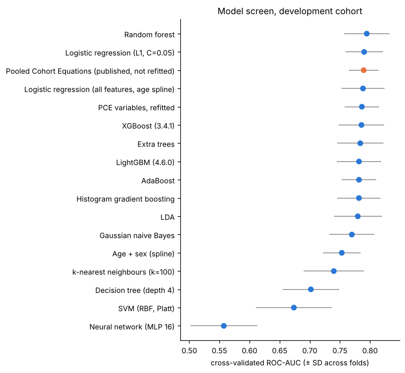
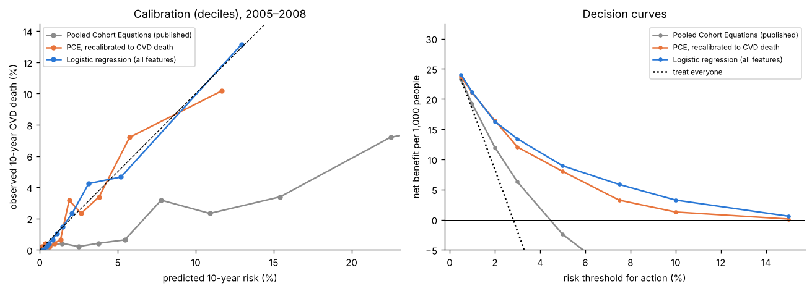
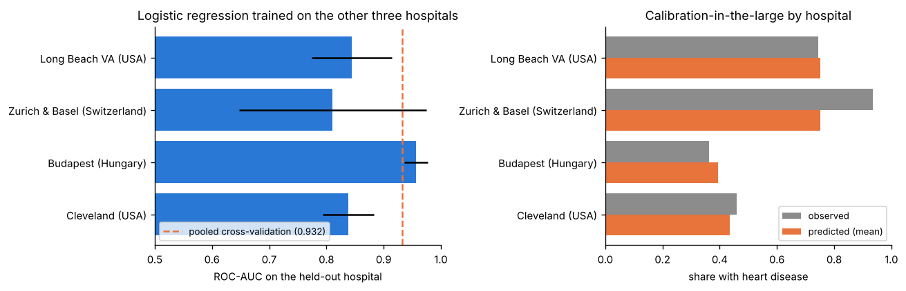

# Cardiovascular Risk Prediction: 10-year CVD mortality model vs the clinical standard

[](https://github.com/Muneera-DSA/Cardiovascular-Risk-Prediction/actions/workflows/ci.yml)

> 📓 **Walkthrough notebook:** [`notebooks/walkthrough.ipynb`](notebooks/walkthrough.ipynb) tells the whole story step by step, with every table and chart already shown. It covers data validation, cleaning, EDA, feature engineering, the model screen, validation and SHAP.

I built a **10-year cardiovascular mortality risk model for US adults** from routinely measured risk factors, and benchmarked it against the clinical standard, the ACC/AHA **Pooled Cohort Equations (PCE)**. The data is **NHANES 1999–2018 linked to the National Death Index**: 23,888 adults aged 40–79 with no prior heart disease or stroke. The model supports one decision: **who should be prioritised for preventive treatment and follow-up**.

**What it achieves** (fitted on 1999–2004, tested once on a later period, 2005–2008):

| | |
|---|---|
| Discrimination | **ROC-AUC 0.822** (95% CI 0.791–0.854) vs 0.799 for the PCE. A small gain (+0.023): significant before correction (p = 0.043), not after Holm correction (p = 0.13) |
| Calibration | **Observed/expected 1.01, slope 1.00**: its risk percentages mean what they say. The published PCE predicts about 4× too much risk of cardiovascular *death* (O/E 0.26) |
| Targeting | Flagging the top 10% by risk captures **47% of cardiovascular deaths**, against 36% with the PCE |
| Newest data | A Cox survival model reaches **C-index 0.807 on 2009–2018** (PCE 0.784); predicted 5-year risk 1.01% vs 0.93% observed |
| Explainability | Exact SHAP: age, waist, kidney function, blood-pressure treatment, BMI, sex, income, smoking |

**How it was built:** cohort construction from 10 survey cycles and the mortality linkage → data-quality, consistency and selection-bias checks → EDA → an 18-model cross-validated screen (baselines, the PCE, linear models, trees, XGBoost, LightGBM, SVM, neural network) → class-imbalance and leakage tests → temporal validation, calibration and decision curves → Cox survival model → subgroup checks → SHAP → [`MODEL_CARD.md`](MODEL_CARD.md). A simple logistic model won: gradient boosting was significantly worse on the later period.

**Also in this repository:** my earlier 918-patient heart-disease classifier, re-validated hospital by hospital ([last section](#earlier-project-my-918-patient-heart-disease-classifier-re-validated)).

Every number below comes from [`reports/results.md`](reports/results.md), which the code generates.

---

## The model: 10-year cardiovascular death in US adults

### Problem framing

| | |
|---|---|
| **Decision supported** | Who should be prioritised for preventive treatment and follow-up (blood-pressure control, statins, smoking cessation)? |
| **Population** | Adults aged 40–79 examined in NHANES with **no prior heart disease or stroke**, the population the PCE was built for |
| **Outcome** | Death from heart disease or stroke (underlying cause ICD-10 I00–I09, I11, I13, I20–I51, I60–I69) within 10 years of the examination, from the National Death Index |
| **Predictors** | Only what is known at the baseline visit: age, sex, race/ethnicity, total and HDL cholesterol, blood pressure and its treatment, statin use, smoking, diabetes, HbA1c, BMI, waist, kidney function (eGFR), income, education |
| **Benchmark** | The published Pooled Cohort Equations, as used in US clinical guidelines |
| **Primary metrics** | Discrimination (ROC-AUC, PR-AUC, C-index) **and calibration** (observed/expected, intercept, slope). A risk score's numbers must mean what they say |

### Data and validation design

```
NHANES 1999-2018: 59,204 interviewed adults
  -> examined, aged 40-79, not pregnant, linkage-eligible, no prior heart disease or stroke,
     core risk factors measured                                    -> 23,888 people
  -> development 1999-2004 (6,081; 188 CVD deaths in 10 years)     model screen, tuning, selection
  -> temporal test 2005-2008 (4,724; 133 CVD deaths)               used ONCE, for the final comparison
  -> recent 2009-2018 (13,083; median follow-up 5.8 years)         survival model on incomplete follow-up
```

Data quality was checked before modelling ([`results/quality.json`](results/quality.json)):
- **Uniqueness:** one row per person, and no person ID is reused across survey cycles.
- **Consistency:** every internal check passes, including diastolic below systolic, HDL below total cholesterol, and deaths recorded with a cause and within follow-up.
- **Plausible ranges:** at least 99.97% of every variable falls within its plausible range.
- **Class balance:** only 3% of people have the outcome; the imbalance section tests what to do about it.
- **Missing values:** eGFR is missing for about 9%, income for about 9% and statin use for about 12%. They're imputed inside each training fold, with missing-value flags.
- **Excluded people:** the 9% excluded for missing core risk factors are more often Black (SMD +0.31) and lower-income (−0.21), and have a higher death rate (4.9% vs 3.8%). That's a mild selection bias, reported rather than hidden.
- **Survey design:** survey weights are kept, and weighted prevalences are reported alongside unweighted ones.
- **Mortality-file layout:** checked in every cycle against NCHS's own read-in program.

### Results

**Model screen.** 17 models (including XGBoost and LightGBM) plus the published PCE, scored by 5×5 repeated cross-validation on development data only ([details](reports/results.md#24-model-screen-development-cohort-cross-validation)):



- **The top eleven span only 0.780–0.795, and none is significantly better than another** (corrected resampled t-test, Holm). That includes XGBoost (0.786) and LightGBM (0.782), run on the same folds via [`notebooks/xgboost_lightgbm_on_colab.ipynb`](notebooks/xgboost_lightgbm_on_colab.ipynb).
- **The published PCE, never fitted to this data, scores 0.790.**
- Class weights, oversampling and SMOTE all lowered ROC-AUC, and they inflated average predicted risk from 3.1% to 32–36%. Imbalance is handled by keeping the data as it is and choosing thresholds explicitly.

**Temporal validation: fit on 1999–2004, tested once on 2005–2008.**

| Model | ROC-AUC (95% CI) | PR-AUC | Observed / expected | Calibration slope |
|---|---|---|---|---|
| Age + sex only | 0.759 (0.717–0.801) | 0.086 | 0.94 | 1.08 |
| **Pooled Cohort Equations (published)** | 0.799 (0.765–0.833) | 0.096 | **0.26** | 0.90 |
| PCE recalibrated to CVD death | 0.799 (0.765–0.833) | 0.096 | 0.97 | 0.96 |
| PCE variables, refitted | 0.805 (0.772–0.838) | 0.103 | 0.97 | 1.01 |
| Gradient boosting (all features) | 0.798 (0.762–0.833) | 0.111 | 0.97 | 1.11 |
| **Logistic regression (all features), chosen** | **0.822 (0.791–0.854)** | **0.140** | **1.01** | **1.00** |



**What this means**
1. **Calibration is the big difference.** The PCE predicts an average 10-year risk of 10.9% where 2.8% died of cardiovascular disease. That's not a flaw: it predicts fatal *and* non-fatal events, and this outcome is death only. Recalibration fixes it. The new model needs no fix (slope 1.00, intercept +0.01).
2. **Discrimination gains are small and uncertain.**
   - Against the PCE: +0.023 ROC-AUC (95% CI +0.001 to +0.046, DeLong p = 0.043, **Holm-adjusted p = 0.13**).
   - Against the same nine PCE variables refitted to this outcome: +0.017 (p = 0.07).
   - The extra measurements add little discrimination; claiming more would overstate the evidence.
3. **The gain shows most among the highest-risk people.** Flagging the top 10% by risk captures **47% of cardiovascular deaths**, against 36% with the PCE.
4. **Decision curves:** at a 5% action threshold the model delivers 8.9 net true positives per 1,000 people, against 8.0 for the recalibrated PCE. The uncorrected PCE delivers −2.4, worse than doing nothing, because it overestimates risk.
5. **Simple beats complex.** Gradient boosting was significantly worse than logistic regression on the test period (−0.024, p = 0.007), as the pre-specified selection rule anticipated.

**Survival analysis on 2009–2018, the newest data.** A cause-specific Cox model fitted on 1999–2004 reaches a **C-index of 0.807** on 2009–2018, against 0.784 for the PCE and 0.731 for age alone. Predicted 5-year risk is 1.01% against **0.93% observed** (Kaplan–Meier). Hazard ratios per standard deviation: age 2.3, smoking 1.3, systolic BP 1.2, BP treatment 1.2.

### Leakage and design checks

| Design | ROC-AUC | vs correct |
|---|---|---|
| **Correct:** baseline variables, temporal split | 0.822 | |
| + death-certificate diabetes and hypertension flags (recorded *after* death) | 0.840 | +0.018 (fake gain) |
| + people who already had heart disease or stroke | 0.832 | +0.010 (different question) |
| Random split instead of temporal | 0.797 | −0.026 (no hidden optimism here) |

### Subgroups and explanations
- **Discrimination by group:** good in women (0.85) and lower in men (0.79). Within ages 60–79 it is 0.74, because age itself varies less.
- **Calibration by group:**
  - **Hispanic adults:** both models over-predict (observed/expected 0.71).
  - **People with diabetes:** both models over-predict (0.84).
  - A deployment would need recalibration for these groups.
- **Exact SHAP** for the logistic model: age dominates, followed by waist, kidney function, blood-pressure treatment, BMI, sex, income and smoking. Cholesterol and HDL add little to predicting cardiovascular *death* once these are known.

---

## Earlier project: my 918-patient heart-disease classifier, re-validated

My earlier notebook trained classifiers on the Kaggle *Heart Failure Prediction* file (918 patients). To test whether they would work at a new hospital, I matched every row to its hospital in the UCI source files: 916 by exact match, and 2 by their neighbouring rows ([details](reports/results.md#part-1--audit-of-the-original-918-patient-notebook)).

| Finding | Evidence |
|---|---|
| **"Cholesterol = 0" is a hospital marker.** 172 patients, every Swiss patient among them; 88% of them have heart disease | It produced the backwards finding that heart patients have *lower* cholesterol (176 vs 227). With zeros treated as missing: 251 vs 239 |
| **The reported "test ROC-AUC" was balanced accuracy** | `roc_auc_score` was given 0/1 predictions. The real test ROC-AUC is 0.93–0.94 for logistic regression, random forest, SVM and XGBoost |
| **The final "best model" cell trained on 9 dummy columns only** | Reproduces the notebook's 0.8556 exactly |
| **Class balance is not the problem** | 55% have heart disease; class weighting changes ROC-AUC by under 0.001. The imbalance that matters is *between hospitals* (36%–93% disease) |
| **The test set was reused for model selection, and the differences are noise** | 184 test patients; the 95% intervals overlap almost completely. Twelve of 15 models, including XGBoost and LightGBM, are statistically indistinguishable in repeated cross-validation |
| **It does not transfer to a new hospital** | Trained on three hospitals and tested on the fourth: ROC-AUC 0.79–0.84 at Cleveland and 0.73–0.81 at the Swiss hospital for the four models compared, against about 0.93 in pooled cross-validation. At the Swiss hospital the models predict a 71–75% disease rate where 93% had disease |



---

## Reproduce

```bash
git clone https://github.com/Muneera-DSA/Cardiovascular-Risk-Prediction.git
cd Cardiovascular-Risk-Prediction
pip install -e ".[dev]"
python -m cvd_risk.experiments     # the model, about 4 minutes, from the committed NHANES cohort
python -m cvd_risk.audit918        # earlier 918-patient project (needs data/heart_failure_918.csv from Kaggle; see data/README.md)
python -m cvd_risk.report          # rebuilds reports/results.md and the figures
pytest -q                          # 23 tests on synthetic data in the official formats
```

XGBoost and LightGBM results (`results/benchmark_extra.json`, `results/part1_extra.json`) come from [`notebooks/xgboost_lightgbm_on_colab.ipynb`](notebooks/xgboost_lightgbm_on_colab.ipynb) (`--stages benchmark_extra` and `audit918 --extra-only`). The steps above merge them into the tables automatically, on the same folds.

To rebuild the cohort itself from the CDC files, run `python -m cvd_risk.build_data` or [`notebooks/build_cohort_on_colab.ipynb`](notebooks/build_cohort_on_colab.ipynb). It takes about 10 minutes and about 150 MB of downloads.

## Project structure

```
├── src/cvd_risk/
│   ├── config.py        # every analytical choice in one place
│   ├── nhanes.py        # download, read, harmonise 10 survey cycles, link mortality, build cohort
│   ├── pce.py           # Pooled Cohort Equations (tested against the guideline's worked example)
│   ├── models.py        # model factories, imbalance strategies, Cox model, C-index, Kaplan-Meier
│   ├── experiments.py   # quality, EDA, model screen, imbalance, selection, temporal, survival, leakage, subgroups, SHAP
│   ├── stats.py         # DeLong, bootstrap, calibration, decision curves, Holm
│   ├── uci.py, audit918.py   # earlier 918-patient project, re-validated by hospital
│   └── report.py        # results.md and figures
├── data/                # NHANES cohort (public domain) + UCI hospitals (CC BY 4.0); see data/README.md
├── results/             # every number, as JSON
├── reports/             # results.md + figures
├── notebooks/           # walkthrough + Colab cohort builder
└── MODEL_CARD.md
```

## Limitations
- **Death only.** NHANES records deaths but not non-fatal heart attacks or strokes, so the PCE (built for both) is compared on ranking and after recalibration.
- **About 190 development events.** That limits how complex a model the data can support, and keeps the confidence intervals wide.
- **The public-use mortality files are perturbed for confidentiality.** Statin use is self-reported, and analysis is complete-case for the core risk factors.
- **Evaluation is unweighted.** Results describe this cohort, not survey-weighted national estimates.

## Data sources
- NHANES and the NCHS Linked Mortality Files (CDC/NCHS; public domain).
- UCI Heart Disease (Janosi, Steinbrunn, Pfisterer & Detrano; CC BY 4.0).
- Details and citations: [`data/README.md`](data/README.md).
