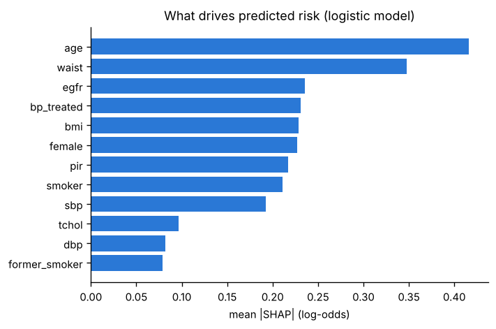

# Results (generated by `python -m cvd_risk.report`; do not edit by hand)

## Part 1 — Audit of the original 918-patient notebook

### 1.1 Data quality

- 918 patients, 0 missing cells, 0 exact duplicates.
- **Cholesterol recorded as 0 for 172 patients** and resting blood pressure 0 for 1: physiologically impossible, so these are missing values.
- Hospital identified for 918 of 918 rows by exact match to the UCI source files.

| Hospital | Patients | Heart disease | Cholesterol = 0 |
|---|---|---|---|
| Cleveland (USA) | 303 | 46% | 0% |
| Budapest (Hungary) | 293 | 36% | 0% |
| Zurich & Basel (Switzerland) | 123 | 93% | 100% |
| Long Beach VA (USA) | 199 | 74% | 25% |

### 1.2 Cholesterol = 0 is a hospital marker, not a measurement

- Heart disease in patients with cholesterol 0: **88%**, versus 48% when measured.
- The 0/1 flag *alone* gives ROC-AUC 0.625.
- Mean cholesterol with the zeros left in: 176 (disease) vs 227 (no disease) — the notebook's 'heart patients have lower cholesterol'. With zeros treated as missing: 251 vs 239 (Mann–Whitney p = 0.002). The paradox was an artefact.

### 1.3 The original pipeline, reproduced exactly

Same encoding, split (`random_state=10`, stratified; 734 train / 184 test) and scaling as the notebook.

| Model | CV ROC-AUC | Notebook 'test_score' | Balanced accuracy | Actual test ROC-AUC (95% CI) |
|---|---|---|---|---|
| LogisticRegression | 0.922 | 0.888 | 0.888 | **0.935** (0.898–0.973) |
| KNeighborsClassifier | 0.904 | 0.861 | 0.861 | **0.914** (0.870–0.958) |
| DecisionTreeClassifier | 0.777 | 0.786 | 0.786 | **0.786** (0.726–0.846) |
| RandomForestClassifier | 0.921 | 0.900 | 0.900 | **0.943** (0.910–0.977) |
| SVC | 0.926 | 0.900 | 0.900 | **0.931** (0.892–0.971) |
| XGBClassifier | 0.913 | 0.902 | 0.902 | **0.938** (0.901–0.975) |

- The notebook's 'test_score' is identical to balanced accuracy: `roc_auc_score` was given 0/1 predictions, not probabilities.
- The final 'best classifier' cell trained on `X_train` after it had been overwritten with the 9 dummy columns only. It reproduces the notebook's 0.856 exactly (0.8556); with all features: 0.8570.
- With 184 test patients, the 95% intervals above overlap almost completely: the ranking between models is noise.

### 1.3b Class balance

55% of patients have heart disease (near-balanced overall, but 36%–93% by hospital). Class weighting tested on the same repeated CV folds:

| Model / weighting | CV ROC-AUC | CV balanced accuracy |
|---|---|---|
| Logistic regression / none | 0.929 | 0.866 |
| Logistic regression / class weights | 0.929 | 0.865 |
| Random forest / none | 0.931 | 0.865 |
| Random forest / class weights | 0.932 | 0.867 |

### 1.4 Corrected model comparison

16 models, 10×5-fold repeated stratified cross-validation, all preprocessing inside the folds (zeros → missing → median + missing flag). p-values: Nadeau–Bengio corrected resampled t-test against the best model, Holm-adjusted.

| Model | CV ROC-AUC ± SD | Train ROC-AUC | Brier | Accuracy | p vs best (Holm) |
|---|---|---|---|---|---|
| Extra trees | 0.932 ± 0.019 | 0.978 | 0.100 | 0.867 | 1.000 |
| Random forest | 0.931 ± 0.020 | 0.988 | 0.100 | 0.871 | 1.000 |
| Histogram gradient boosting | 0.929 ± 0.019 | 0.985 | 0.098 | 0.869 | 1.000 |
| SVM (RBF) | 0.928 ± 0.018 | 0.961 | 0.100 | 0.869 | 1.000 |
| Logistic regression | 0.928 ± 0.019 | 0.937 | 0.102 | 0.870 | 1.000 |
| LDA | 0.928 ± 0.019 | 0.936 | 0.105 | 0.870 | 1.000 |
| Gradient boosting | 0.928 ± 0.018 | 0.989 | 0.100 | 0.869 | 1.000 |
| XGBoost (3.4.1) | 0.928 ± 0.020 | 0.990 | 0.099 | 0.871 | 1.000 |
| Logistic regression (L1, C=0.1) | 0.926 ± 0.018 | 0.931 | 0.106 | 0.860 | 0.931 |
| LightGBM (4.6.0) | 0.925 ± 0.019 | 1.000 | 0.108 | 0.860 | 1.000 |
| k-nearest neighbours (k=15) | 0.921 ± 0.019 | 0.944 | 0.107 | 0.860 | 0.783 |
| AdaBoost | 0.919 ± 0.019 | 0.950 | 0.188 | 0.862 | 0.021 |
| Gaussian naive Bayes | 0.916 ± 0.022 | 0.923 | 0.250 | 0.721 | 0.427 |
| Neural network (MLP 16) | 0.907 ± 0.021 | 0.988 | 0.124 | 0.842 | 0.023 |
| Decision tree (depth 4) | 0.894 ± 0.029 | 0.934 | 0.125 | 0.833 | 0.020 |
| Prior only (no information) | 0.500 ± 0.000 | 0.500 | 0.247 | 0.553 | <0.001 |

**12 models are statistically indistinguishable from the best.**

### 1.5 External validation: train on three hospitals, test on the fourth

| Held-out hospital | n | Disease rate | Model | ROC-AUC (95% CI) | Mean predicted | Calibration intercept | Accuracy |
|---|---|---|---|---|---|---|---|
| Cleveland (USA) | 303 | 46% | Extra trees | 0.812 (0.764–0.861) | 49% | -0.26 | 72% |
| Cleveland (USA) | 303 | 46% | Random forest | 0.808 (0.759–0.858) | 49% | -0.25 | 71% |
| Cleveland (USA) | 303 | 46% | Histogram gradient boosting | 0.787 (0.735–0.838) | 45% | +0.09 | 74% |
| Cleveland (USA) | 303 | 46% | Logistic regression | 0.838 (0.794–0.883) | 43% | +0.24 | 77% |
| Budapest (Hungary) | 293 | 36% | Extra trees | 0.958 (0.936–0.980) | 42% | -0.47 | 92% |
| Budapest (Hungary) | 293 | 36% | Random forest | 0.959 (0.938–0.981) | 43% | -0.53 | 92% |
| Budapest (Hungary) | 293 | 36% | Histogram gradient boosting | 0.949 (0.924–0.975) | 42% | -0.62 | 91% |
| Budapest (Hungary) | 293 | 36% | Logistic regression | 0.957 (0.937–0.977) | 40% | -0.32 | 90% |
| Zurich & Basel (Switzerland) | 123 | 93% | Extra trees | 0.767 (0.611–0.924) | 73% | +2.24 | 77% |
| Zurich & Basel (Switzerland) | 123 | 93% | Random forest | 0.780 (0.616–0.945) | 71% | +2.34 | 82% |
| Zurich & Basel (Switzerland) | 123 | 93% | Histogram gradient boosting | 0.732 (0.542–0.921) | 73% | +2.77 | 76% |
| Zurich & Basel (Switzerland) | 123 | 93% | Logistic regression | 0.811 (0.647–0.975) | 75% | +2.20 | 85% |
| Long Beach VA (USA) | 199 | 74% | Extra trees | 0.872 (0.811–0.933) | 72% | +0.18 | 88% |
| Long Beach VA (USA) | 199 | 74% | Random forest | 0.876 (0.815–0.938) | 72% | +0.20 | 88% |
| Long Beach VA (USA) | 199 | 74% | Histogram gradient boosting | 0.862 (0.796–0.927) | 74% | -0.01 | 87% |
| Long Beach VA (USA) | 199 | 74% | Logistic regression | 0.844 (0.774–0.914) | 75% | -0.07 | 88% |

### 1.6 Statistical tests and odds ratios

| Feature | Test | p (Holm) | Effect size |
|---|---|---|---|
| Sex | chi-square | <0.001 | Cramér's V = 0.30 |
| ChestPainType | chi-square | <0.001 | Cramér's V = 0.54 |
| RestingECG | chi-square | 0.004 | Cramér's V = 0.11 |
| ExerciseAngina | chi-square | <0.001 | Cramér's V = 0.49 |
| ST_Slope | chi-square | <0.001 | Cramér's V = 0.62 |
| FastingBS | chi-square | <0.001 | Cramér's V = 0.26 |
| Age | Mann-Whitney U | <0.001 | P(diseased > healthy) = 0.67 |
| RestingBP (zeros as missing) | Mann-Whitney U | 0.001 | P(diseased > healthy) = 0.57 |
| Cholesterol (zeros as missing) | Mann-Whitney U | 0.003 | P(diseased > healthy) = 0.57 |
| MaxHR | Mann-Whitney U | <0.001 | P(diseased > healthy) = 0.26 |
| Oldpeak | Mann-Whitney U | <0.001 | P(diseased > healthy) = 0.74 |

| Adjusted logistic model | Odds ratio | 95% CI | p |
|---|---|---|---|
| Age (per 10) | 1.20 | 0.92–1.56 | 0.179 |
| RestingBP (per 10) | 1.06 | 0.93–1.21 | 0.358 |
| Cholesterol (per 40) | 1.09 | 0.93–1.27 | 0.272 |
| FastingBS | 2.60 | 1.48–4.55 | <0.001 |
| MaxHR (per 10) | 0.98 | 0.88–1.08 | 0.678 |
| Oldpeak (per 1) | 1.49 | 1.17–1.88 | 0.001 |
| Cholesterol_missing | 5.72 | 2.91–11.24 | <0.001 |
| Sex_M | 4.70 | 2.68–8.22 | <0.001 |
| ChestPainType_ATA | 0.17 | 0.09–0.33 | <0.001 |
| ChestPainType_NAP | 0.20 | 0.12–0.34 | <0.001 |
| ChestPainType_TA | 0.25 | 0.10–0.59 | 0.002 |
| RestingECG_Normal | 0.83 | 0.48–1.42 | 0.491 |
| RestingECG_ST | 0.72 | 0.36–1.44 | 0.349 |
| ExerciseAngina_Y | 2.46 | 1.52–4.00 | <0.001 |
| ST_Slope_Flat | 4.35 | 1.84–10.28 | <0.001 |
| ST_Slope_Up | 0.39 | 0.16–0.97 | 0.042 |

SHAP (exact, logistic regression, mean |log-odds contribution|): ST_Slope 1.09, ChestPainType 0.79, Cholesterol 0.51, Sex 0.47, ExerciseAngina 0.42, Oldpeak 0.35, FastingBS 0.34, Age 0.13, RestingBP 0.08, RestingECG 0.07, MaxHR 0.06. Additivity error 2.2e-15.

## Part 2 — 10-year cardiovascular death in US adults (NHANES 1999–2018 + National Death Index)

### 2.1 Cohort

| Remaining | Step | Removed |
|---|---|---|
| 59,204 | adults in NHANES 1999-2018 (all ages, interviewed) |  |
| 56,367 | examined at the mobile examination centre | −2,837 |
| 30,704 | aged 40-79 | −25,663 |
| 30,673 | not pregnant | −31 |
| 30,603 | eligible for mortality linkage | −70 |
| 26,289 | no self-reported heart disease or stroke (prevention population) | −4,314 |
| 23,888 | core risk factors measured (cholesterol, HDL, BP, BP treatment, smoking, diabetes) | −2,401 |
| 23,888 | follow-up time recorded |  |

Baseline characteristics (median (IQR) or %):

|  | development | recent | temporal_test |
|---|---|---|---|
| n | 6081 | 13083 | 4724 |
| age | 56.0 (47.0-66.0) | 56.0 (48.0-65.0) | 56.0 (47.0-65.0) |
| sbp | 128.0 (116.7-141.3) | 125.3 (114.7-137.3) | 124.3 (114.7-137.3) |
| dbp | 74.0 (67.3-81.3) | 72.7 (66.0-80.0) | 72.7 (65.3-80.0) |
| tchol | 208.0 (184.0-234.0) | 198.0 (172.0-224.0) | 202.0 (177.0-229.0) |
| hdl | 50.0 (41.0-62.0) | 51.0 (42.0-63.0) | 51.0 (42.0-62.0) |
| hba1c | 5.5 (5.2-5.8) | 5.7 (5.4-6.0) | 5.6 (5.3-5.9) |
| bmi | 28.0 (24.8-31.8) | 28.6 (25.0-33.1) | 28.3 (24.9-32.3) |
| egfr | 90.8 (77.5-101.8) | 93.3 (78.2-103.9) | 91.7 (77.5-102.6) |
| pir | 2.7 (1.3-4.6) | 2.4 (1.2-4.5) | 2.6 (1.3-4.8) |
| female | 50.7% | 52.5% | 51.3% |
| race_black | 18.9% | 21.7% | 20.8% |
| race_hispanic | 27.6% | 26.9% | 25.6% |
| smoker | 21.0% | 18.4% | 21.3% |
| former_smoker | 31.2% | 26.4% | 28.9% |
| diabetes | 15.0% | 20.6% | 16.9% |
| bp_treated | 27.5% | 33.2% | 31.1% |
| lipid_treated | 16.9% | 24.0% | 25.3% |
| education_college | 44.0% | 53.5% | 47.4% |
| 10-year CVD death (complete follow-up) | 3.09% | 8.25% | 2.82% |
| median follow-up, years | 16.9 | 5.8 | 12.3 |

### 2.2 Data quality

| Variable | n | Within plausible range | Observed range |
|---|---|---|---|
| sbp | 23888 | 100.00% | 64.7–256.0 |
| dbp | 23805 | 99.97% | 10.0–132.0 |
| tchol | 23888 | 99.97% | 75.0–813.0 |
| hdl | 23888 | 99.99% | 6.0–226.0 |
| hba1c | 23857 | 100.00% | 2.0–18.8 |
| bmi | 23634 | 100.00% | 13.2–130.2 |
| waist | 23224 | 100.00% | 59.4–177.9 |
| egfr | 21638 | 99.99% | 2.8–179.7 |
| pir | 21768 | 100.00% | 0.0–5.0 |
| age | 23888 | 100.00% | 40.0–79.0 |

Uniqueness: rows 23,888, duplicate person ids 0, ids shared across cycles 0, duplicate rows all columns 0.

| Consistency check | Share passing |
|---|---|
| diastolic < systolic | 100.00% |
| HDL < total cholesterol | 100.00% |
| not both current and former smoker | 100.00% |
| derivation: HbA1c >= 6.5% always coded as diabetes | 100.00% |
| CVD death implies death | 100.00% |
| deaths have a recorded cause | 100.00% |
| follow-up time not negative | 100.00% |
| deaths occur within the follow-up of survivors (same cycle) | 100.00% |

Cross-checks: median HbA1c 7.0% with diabetes vs 5.5% without; median systolic BP 132 treated vs 123 untreated; BMI-waist correlation 0.89.

Missing values (share): dbp 0.3%, lipid_treated 12.1%, hba1c 0.1%, bmi 1.1%, waist 2.8%, egfr 9.4%, pir 8.9%, education_college 0.1%.

Excluded for missing core risk factors: 2,401 (9.1%). Standardised differences excluded vs included: age +0.00, female +0.07, race_black +0.31, race_hispanic -0.09, pir -0.21, bmi +0.04, sbp +0.18. 10-year CVD death: excluded 4.89%, included 3.82%.

### 2.3 Exploratory analysis

10-year CVD death 2.97%; non-CVD death (competing) 9.02% (n = 10,805).

| PCE risk category | n | Mean PCE risk (fatal + non-fatal ASCVD) | Observed 10-year CVD death |
|---|---|---|---|
| <5% | 4501 | 2.2% | 0.58% |
| 5-7.5% | 1217 | 6.2% | 1.15% |
| 7.5-20% | 3060 | 12.8% | 2.84% |
| >=20% | 2027 | 31.8% | 9.57% |

| Variable | Test | p (Holm) | Effect size |
|---|---|---|---|
| age | Mann-Whitney U | <0.001 | P(event>non-event) 0.75 |
| sbp | Mann-Whitney U | <0.001 | P(event>non-event) 0.66 |
| dbp | Mann-Whitney U | 0.001 | P(event>non-event) 0.44 |
| tchol | Mann-Whitney U | 1.000 | P(event>non-event) 0.50 |
| hdl | Mann-Whitney U | 0.205 | P(event>non-event) 0.47 |
| hba1c | Mann-Whitney U | <0.001 | P(event>non-event) 0.61 |
| bmi | Mann-Whitney U | 1.000 | P(event>non-event) 0.50 |
| egfr | Mann-Whitney U | <0.001 | P(event>non-event) 0.32 |
| pir | Mann-Whitney U | <0.001 | P(event>non-event) 0.37 |
| female | chi-square | 0.006 | risk ratio 0.68 |
| race_black | chi-square | 0.072 | risk ratio 1.37 |
| race_hispanic | chi-square | 0.205 | risk ratio 0.78 |
| smoker | chi-square | 0.028 | risk ratio 1.43 |
| former_smoker | chi-square | 0.033 | risk ratio 1.38 |
| diabetes | chi-square | <0.001 | risk ratio 2.27 |
| bp_treated | chi-square | <0.001 | risk ratio 2.82 |
| lipid_treated | chi-square | 0.016 | risk ratio 1.54 |
| education_college | chi-square | <0.001 | risk ratio 0.50 |

### 2.4 Model screen (development cohort, cross-validation)

5x5 stratified CV on 6,081 people (188 events).

| Model | CV ROC-AUC ± SD | CV PR-AUC | Brier | p vs best (Holm) |
|---|---|---|---|---|
| Random forest | 0.795 ± 0.038 | 0.146 | 0.0284 | 1.000 |
| Logistic regression (L1, C=0.05) | 0.790 ± 0.031 | 0.152 | 0.0285 | 1.000 |
| Pooled Cohort Equations (published, not refitted) | 0.789 ± 0.025 | 0.153 | 0.0422 | 1.000 |
| Logistic regression (all features, age spline) | 0.788 ± 0.035 | 0.155 | 0.0285 | 1.000 |
| PCE variables, refitted | 0.786 ± 0.029 | 0.138 | 0.0285 | 1.000 |
| XGBoost (3.4.1) | 0.786 ± 0.038 | 0.149 | 0.0285 | 1.000 |
| Extra trees | 0.784 ± 0.038 | 0.129 | 0.0288 | 1.000 |
| LightGBM (4.6.0) | 0.782 ± 0.037 | 0.155 | 0.0286 | 1.000 |
| AdaBoost | 0.782 ± 0.029 | 0.135 | 0.1086 | 1.000 |
| Histogram gradient boosting | 0.782 ± 0.036 | 0.142 | 0.0286 | 1.000 |
| LDA | 0.780 ± 0.040 | 0.138 | 0.0322 | 1.000 |
| Gaussian naive Bayes | 0.770 ± 0.037 | 0.102 | 0.1431 | 1.000 |
| Age + sex (spline) | 0.753 ± 0.031 | 0.102 | 0.0290 | 0.453 |
| k-nearest neighbours (k=100) | 0.740 ± 0.050 | 0.119 | 0.0291 | 0.074 |
| Decision tree (depth 4) | 0.702 ± 0.047 | 0.074 | 0.0298 | <0.001 |
| SVM (RBF, Platt) | 0.674 ± 0.063 | 0.114 | 0.0295 | 0.002 |
| Neural network (MLP 16) | 0.557 ± 0.056 | 0.060 | 0.0439 | <0.001 |
| Prior only (no information) | 0.500 ± 0.000 | 0.031 | 0.0300 | <0.001 |

### 2.5 Class imbalance

| Model / strategy | CV ROC-AUC | CV PR-AUC | Brier | Mean predicted | Observed |
|---|---|---|---|---|---|
| logistic / none | 0.787 | 0.152 | 0.0285 | 3.1% | 3.1% |
| logistic / class_weight | 0.779 | 0.159 | 0.1742 | 35.6% | 3.1% |
| logistic / oversample | 0.778 | 0.156 | 0.1746 | 35.6% | 3.1% |
| logistic / smote | 0.765 | 0.130 | 0.1659 | 32.4% | 3.1% |
| hgb / none | 0.774 | 0.133 | 0.0288 | 2.7% | 3.1% |
| hgb / class_weight | 0.761 | 0.124 | 0.1052 | 25.0% | 3.1% |
| hgb / oversample | 0.735 | 0.119 | 0.0456 | 8.4% | 3.1% |
| hgb / smote | 0.701 | 0.087 | 0.0521 | 10.5% | 3.1% |

### 2.6 Model selection

Tuned logistic {'C': 1.0} CV AUC 0.788; tuned gradient boosting {'learning_rate': 0.03, 'max_leaf_nodes': 4, 'min_samples_leaf': 150} CV AUC 0.786. Difference -0.0021 (corrected t p = 0.875). Rule: choose gradient boosting only if it beats logistic regression by > 0.005 AUC with p < 0.05 (corrected resampled t-test). **Chosen: logistic.**

### 2.7 Temporal validation (fit on 1999–2004, test once on 2005–2008)

Development 6,081 (188 CVD deaths); test 4,724 (133 CVD deaths). PCE recalibration on development data: intercept -1.64, slope 0.94.

| Model | ROC-AUC (95% CI) | PR-AUC | Brier | Cal. intercept | Cal. slope | Observed / expected |
|---|---|---|---|---|---|---|
| Age + sex | 0.759 (0.717–0.801) | 0.086 | 0.0265 | -0.07 | 1.08 | 0.94 |
| PCE variables, refitted | 0.805 (0.772–0.838) | 0.103 | 0.0263 | -0.04 | 1.01 | 0.97 |
| Logistic regression (all features) | 0.822 (0.791–0.854) | 0.140 | 0.0258 | +0.01 | 1.00 | 1.01 |
| Gradient boosting (all features) | 0.798 (0.762–0.833) | 0.111 | 0.0262 | -0.03 | 1.11 | 0.97 |
| Pooled Cohort Equations (published) | 0.799 (0.765–0.833) | 0.096 | 0.0401 | -1.59 | 0.90 | 0.26 |
| PCE, recalibrated to CVD death | 0.799 (0.765–0.833) | 0.096 | 0.0265 | -0.04 | 0.96 | 0.97 |

| vs published PCE | ΔAUC (95% CI) | DeLong p | Holm-adjusted p |
|---|---|---|---|
| Age + sex | -0.040 (-0.068 to -0.011) | 0.006 | 0.024 |
| PCE variables, refitted | +0.006 (-0.006 to +0.018) | 0.315 | 0.629 |
| Logistic regression (all features) | +0.023 (+0.001 to +0.046) | 0.043 | 0.128 |
| Gradient boosting (all features) | -0.001 (-0.028 to +0.026) | 0.940 | 0.940 |

Chosen model vs refitted PCE variables: ΔAUC +0.017 (-0.001 to +0.036), p = 0.065.

| Flag highest-risk | Pooled Cohort Equations (published) | Logistic regression (all features) | Age + sex |
|---|---|---|---|
| top 10% | 36% | 47% | 38% |
| top 20% | 62% | 63% | 57% |

### 2.8 Survival analysis (cause-specific Cox; other deaths censored)

| Predictor | HR per SD | 95% CI |
|---|---|---|
| age | 2.32 | 2.03–2.66 |
| female | 0.81 | 0.72–0.90 |
| race_black | 1.08 | 0.98–1.19 |
| race_hispanic | 0.82 | 0.73–0.92 |
| race_other | 0.91 | 0.81–1.03 |
| tchol | 0.95 | 0.86–1.05 |
| hdl | 1.09 | 0.98–1.21 |
| sbp | 1.22 | 1.11–1.35 |
| dbp | 0.95 | 0.87–1.04 |
| bp_treated | 1.22 | 1.11–1.34 |
| lipid_treated | 0.92 | 0.84–1.00 |
| smoker | 1.31 | 1.19–1.46 |
| former_smoker | 1.09 | 0.98–1.20 |
| diabetes | 1.10 | 0.99–1.22 |
| hba1c | 1.14 | 1.04–1.26 |
| bmi | 0.80 | 0.64–0.99 |
| waist | 1.36 | 1.09–1.68 |
| egfr | 0.91 | 0.83–1.00 |
| pir | 0.83 | 0.74–0.93 |
| education_college | 0.86 | 0.77–0.96 |
| lipid_treated_missing | 1.04 | 0.94–1.15 |
| bmi_missing | 1.06 | 0.98–1.15 |
| waist_missing | 1.03 | 0.94–1.13 |
| egfr_missing | 1.05 | 0.95–1.17 |
| pir_missing | 1.00 | 0.91–1.09 |
| age_sq | 1.12 | 1.00–1.24 |

| Cohort | n | CVD deaths | Median follow-up (y) | C-index Cox | C-index PCE | C-index age | Predicted vs Kaplan–Meier |
|---|---|---|---|---|---|---|---|
| temporal test 2005-2008 | 4,724 | 199 | 12.3 | 0.823 | 0.804 | 0.768 | 3.42% vs 2.94% (10y) |
| recent 2009-2018 | 13,083 | 174 | 5.8 | 0.807 | 0.784 | 0.731 | 1.01% vs 0.93% (5y) |

### 2.9 Leakage and design checks

| Design | ROC-AUC | vs correct | PR-AUC |
|---|---|---|---|
| correct (baseline variables, temporal split) | 0.822 | +0.000 | 0.140 |
| + death-certificate diabetes & hypertension flags (recorded after death) | 0.840 | +0.018 | 0.181 |
| random split instead of temporal (same features) | 0.797 | -0.026 | 0.133 |
| + people who already had heart disease or stroke (prior CVD as a feature) | 0.832 | +0.010 | 0.161 |

### 2.10 Subgroups (temporal test)

| Group | n | Events | PCE AUC | Chosen AUC | O/E recalibrated PCE | O/E chosen |
|---|---|---|---|---|---|---|
| women | 2423 | 58 | 0.823 | 0.851 | 1.07 | 1.10 |
| men | 2301 | 75 | 0.769 | 0.791 | 0.90 | 0.95 |
| non-Hispanic Black | 983 | 34 | 0.812 | 0.830 | 1.03 | 0.97 |
| Hispanic | 1211 | 21 | 0.742 | 0.760 | 0.65 | 0.71 |
| other (mostly non-Hispanic White) | 2530 | 78 | 0.809 | 0.834 | 1.08 | 1.16 |
| age 40-59 | 2753 | 30 | 0.760 | 0.815 | 0.91 | 1.04 |
| age 60-79 | 1971 | 103 | 0.716 | 0.744 | 0.98 | 1.00 |
| diabetes | 799 | 37 | 0.698 | 0.745 | 0.72 | 0.84 |
| no diabetes | 3925 | 96 | 0.825 | 0.836 | 1.12 | 1.09 |

### 2.11 Explanations (SHAP)

Logistic regression, exact SHAP (log-odds), mean |contribution|: age 0.416, waist 0.348, egfr 0.235, bp_treated 0.231, bmi 0.229, female 0.227, pir 0.217, smoker 0.211, sbp 0.192, tchol 0.096, dbp 0.082, former_smoker 0.079. Additivity error 1.4e-14.

